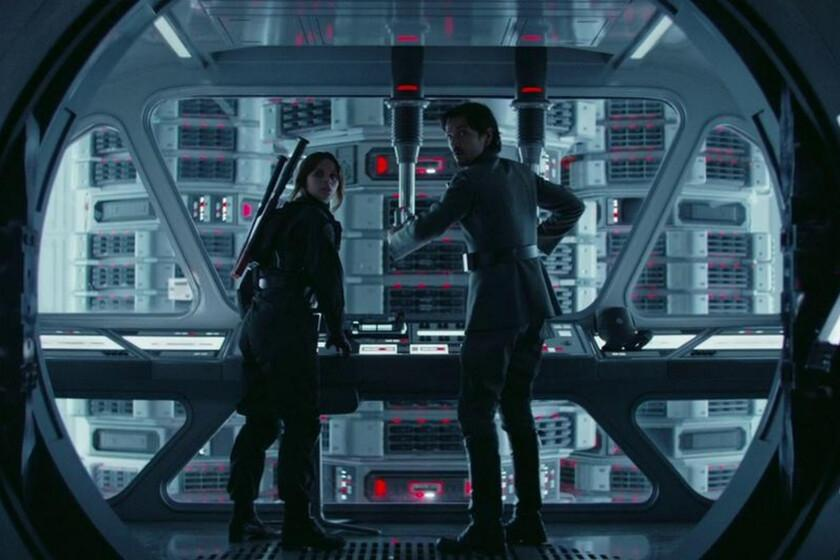

# jax_rouge1_kernel
Convert 1d array in sclices to 3d

## Remember the sciene in Rougue1 where the guy picks the Death Star plans with the Controller?
The scene was very dramatic because they spent way too mcuh time within that process which results in death of both at the end.
If they would have used this grabber, both would be still alive...
